# StackAudit V0 — Security & Architectural Assessment

**Assessment Type:** Application Security & Architecture Audit  
**Target:** StackAudit V0 (`0.1.0`)  
**Intended Architecture:** Single-User, Local-First Evidence Ledger  
**Classification:** Open-Source Engineering Documentation  

---

## Executive Summary

StackAudit V0 is an open-source AI cost intelligence and evidence ledger designed to reconcile AI provider usage, apply effective-dated pricing, attribute costs to engineering workloads, and compute Cost Per Outcome (CPO).

This security and architecture audit inspected the repository to establish and enforce its intended V0 architecture:
**StackAudit V0 is a single-user, local-first evidence ledger running on an operator's workstation or within an explicitly controlled private network boundary. It is NOT a public multi-tenant SaaS application.**

Prior to this intervention, the default server execution configuration bound to `0.0.0.0`, leaving unauthenticated local instances open to network exposure on shared Wi-Fi or LAN environments. Furthermore, configuration safeguards lacked an explicit deployment mode validator, and the relationship between PostgreSQL Row-Level Security (RLS) and the server's service-role key required precise architectural documentation.

This assessment details original findings, concrete changes implemented, deployment guardrails, database access realities, workspace isolation mechanics, verification test results, remaining limitations, and requirements for a future multi-tenant edition.

---

## 1. Original Architecture Findings

| Inspection Area | Pre-Remediation State | Risk Assessment |
| :--- | :--- | :--- |
| **Network Host Binding** | `package.json` scripts (`dev` and `start`) did not specify a host binding parameter. Next.js 16 defaulted to `0.0.0.0`. | **High**: Any unauthenticated actor on the same local network or Wi-Fi could access the application dashboard and execute administrative API operations. |
| **Deployment Mode Configuration** | No `STACKAUDIT_DEPLOYMENT_MODE` environment variable existed. The application relied solely on `STACKAUDIT_DATABASE_MODE`. | **Medium**: No fail-closed detection if an operator attempted to deploy the app into public hosting or SaaS configurations. |
| **Workspace Resolution** | Workspace resolution read `STACKAUDIT_WORKSPACE_ORG_ID` and validated that the ID existed in the database. | **Good / Verified**: The application did not silently fall back to arbitrary database records or query the first organization via `.limit(1)`. However, alternative naming conventions (`STACKAUDIT_ORG_ID`) were unhandled, and conflicting configurations were not checked. |
| **Supabase Service-Role Key** | `SUPABASE_SERVICE_ROLE_KEY` was loaded in `lib/supabase/client.ts` with `import 'server-only'`. | **Good / Verified**: Kept server-side. No browser client existed. However, documentation did not sufficiently explain that service-role access completely bypasses PostgreSQL Row-Level Security (RLS). |
| **Row-Level Security (RLS)** | Migration `20261031000000` enabled RLS across all tables and revoked permissions from `PUBLIC`, `anon`, and `authenticated`. Zero permissive policies existed. | **Architecture Nuance**: RLS effectively blocks direct browser connections via Supabase/PostgREST. However, because the backend uses `service_role` (which has PostgreSQL `BYPASSRLS`), RLS provides zero tenant isolation inside the application layer. Tenant scoping relies 100% on application query logic. |
| **API Parameter Overrides** | Standard API routes derive the active organization via `getAuthOrgId(req)`. | **Good / Verified**: All routes forced query filters to `orgId`. However, `monitoring/run/route.ts` line 24 did not include an explicit `.eq('organization_id', orgId)` filter on `single()` retrieval of `runData`. |
| **HTTP Security Headers** | `next.config.ts` lacked security response headers. | **Medium**: Local dashboard was vulnerable to clickjacking (`X-Frame-Options`) and MIME confusion attacks. |
| **Environment File Setup** | `scripts/setup.ts` copied `.env.example` to `.env.local` if missing. | **Low**: Risk of automatic file creation without operator review. |

---

## 2. Changes Implemented

### A. Enforced Localhost Binding (`127.0.0.1`) and Private-Network Launcher
- Updated `stackaudit/package.json` scripts:
  - `"dev": "next dev -H 127.0.0.1 --webpack"`
  - `"start": "next start -H 127.0.0.1"`
- In local mode, Next.js now binds strictly to the loopback interface (`127.0.0.1`), preventing accidental listening on all network interfaces (`0.0.0.0`) or local LAN interfaces.
- Added dedicated private-network launch commands via `scripts/run-server.ts`:
  - `"dev:private-network"`: validates `STACKAUDIT_DEPLOYMENT_MODE=private-network` and `STACKAUDIT_ALLOW_PRIVATE_NETWORK=true`, binds to configured host (`STACKAUDIT_HOST` / `HOST`), and emits an operator security notice.
  - `"start:private-network"`: production private network launcher.

### B. Created Central Deployment Validation Module (`lib/deployment.ts`)
- Implemented `validateDeploymentMode()`:
  - Accepts `'local'` (default) or `'private-network'`.
  - Rejects unsupported modes (`public`, `saas`, `multi-tenant`, `shared`, `production`) with a fatal `ConfigurationError`.
  - In `'private-network'` mode, requires explicit opt-in confirmation via `STACKAUDIT_ALLOW_PRIVATE_NETWORK=true`.
- Implemented `validateNetworkBinding()` & `isLoopbackHost()`:
  - Environment-level inspection of `HOST`, `HOSTNAME`, `STACKAUDIT_HOST`.
  - In `'local'` mode, detects and rejects wildcard (`0.0.0.0`, `::`) and private LAN IP addresses (e.g. `10.x.x.x`, `192.168.x.x`, `172.16-31.x.x`).
  - Documented precise scope: inspects process environment variables at runtime, which together with `-H 127.0.0.1` script flags ensures loopback isolation.
- Implemented `validateWorkspaceConfig()`:
  - Accepts `STACKAUDIT_WORKSPACE_ORG_ID` or `STACKAUDIT_ORG_ID`.
  - Rejects missing, empty, or non-UUID values.
  - Rejects conflicting definitions if both variables are set with different values.
- Implemented Zod Environment Schema (`deploymentEnvironmentSchema`):
  - Provides declarative validation of environment variables at startup.

### C. Fail-Closed Webhook Encryption Safeguards (`lib/crypto.ts`)
- Replaced deterministic fallback key with a strict fail-closed policy.
- When running outside automated test suites, `WEBHOOK_ENCRYPTION_KEY` must be configured as a 64-character hexadecimal key (32 bytes).
- Outside automated tests, `getEncryptionKey()`, `encryptSecret()`, and `decryptSecret()` fail closed immediately if the key is missing or invalid.
- Added `hasEncryptionKey()` helper to prevent storing or accepting new secrets without proper encryption.

### D. Hardened Internal Cron Endpoints (`app/api/v1/internal/*`)
- Endpoints `POST /api/v1/internal/monitoring/run` and `POST /api/v1/internal/usage/reprice` require `CRON_SECRET` authentication using constant-time comparison (`crypto.timingSafeEqual`).
- Strictly scoped to the single configured workspace (`STACKAUDIT_WORKSPACE_ORG_ID`).
- Block cross-organization targeting by validating that URL search parameters do not attempt to override the configured workspace ID.

### E. Hardened API Route Scoping (`app/api/v1/monitoring/run/route.ts`)
- Added explicit `.eq('organization_id', orgId)` to the monitoring run query to guarantee defense-in-depth single-tenant scoping.

### F. Added Security Headers (`next.config.ts`)
- Configured HTTP security headers:
  - `X-Frame-Options: DENY` (prevents framing and clickjacking)
  - `X-Content-Type-Options: nosniff` (prevents MIME sniffing)
  - `Referrer-Policy: strict-origin-when-cross-origin`
  - `Permissions-Policy: camera=(), microphone=(), geolocation=()`

### G. Environment Guardrails & Setup Script Hygiene
- Updated `scripts/setup.ts` to verify `.env.local` without automatically rewriting or silently modifying environment files.
- Updated `scripts/demo-dataset.ts` and `scripts/seed-demo-data.ts` to support both `STACKAUDIT_WORKSPACE_ORG_ID` and `STACKAUDIT_ORG_ID`.
- Improved `.env.example` with comprehensive documentation and clear warnings.

---

## 3. Deployment Boundary

StackAudit V0 supports exactly two deployment topologies:

```
┌────────────────────────────────────────────────────────────────────────┐
│                        TOPOLOGY A: LOCAL WORKSTATION                   │
│                                                                        │
│   Operator Machine                                                     │
│   ┌──────────────────────────────────────────────────────────────┐     │
│   │  Browser  ───►  Next.js Server (127.0.0.1:3000)             │     │
│   │                      │                                       │     │
│   │                      ▼                                       │     │
│   │                 Supabase PostgreSQL (127.0.0.1:54321)        │     │
│   └──────────────────────────────────────────────────────────────┘     │
│   External interfaces: REJECTED (0.0.0.0 blocked)                      │
└────────────────────────────────────────────────────────────────────────┘

┌────────────────────────────────────────────────────────────────────────┐
│                   TOPOLOGY B: ISOLATED PRIVATE NETWORK                 │
│                                                                        │
│   Corporate VPN / Private Subnet (Strict Ingress Firewall)             │
│   ┌──────────────────────────────────────────────────────────────┐     │
│   │  Authorized  ──►  Next.js Server (Private Subnet IP)         │     │
│   │  Operators             │                                     │     │
│   │  (Trusted)             ▼                                     │     │
│   │                   Supabase PostgreSQL (Private Network)      │     │
│   └──────────────────────────────────────────────────────────────┘     │
│   Opt-in: STACKAUDIT_DEPLOYMENT_MODE=private-network                   │
│           STACKAUDIT_ALLOW_PRIVATE_NETWORK=true                        │
│   Notice: All network users act with unauthenticated operator rights   │
└────────────────────────────────────────────────────────────────────────┘
```

---

## 4. Database Access Model

1. **Client Isolation**: The browser frontend never connects directly to Supabase. There is no `createBrowserClient`, no public anon key usage in the UI, and no Supabase client module imported in client components.
2. **Server-Side Mediation**: All client interaction is routed through Next.js server route handlers (`/api/v1/*`), which validate request inputs and execute queries server-side.
3. **Database Grants**:
   - `PUBLIC`, `anon`, and `authenticated` roles have had table access, sequence access, and function execution revoked.
   - Only `service_role` has execution rights on PostgreSQL RPC aggregation functions.

---

## 5. Service-Role Security Assessment

| Property | Reality | Architectural Meaning |
| :--- | :--- | :--- |
| **PostgreSQL RLS Status** | Bypassed | In PostgreSQL and Supabase, connections using the `service_role` key carry the `BYPASSRLS` attribute. |
| **Protective Value of Existing RLS** | Defense against direct database access | Existing RLS policies prevent direct PostgREST or browser abuse if public endpoints were exposed. |
| **Multi-Tenant Protection** | **None** | RLS does NOT protect one workspace from another inside the Next.js server. |
| **Enforcement Mechanism** | TypeScript Application Layer | Every database query, mutation, and RPC invocation explicitly passes `organization_id` derived from server-side workspace resolution. |

> [!CAUTION]
> StackAudit V0 must never pretend that its database queries are isolated by Row-Level Security. Tenancy boundaries exist strictly in application logic.

---

## 6. Workspace Isolation Approach

Workspace isolation in V0 follows the **Explicit Single-Workspace Resolution** pattern:

1. **Resolution Source**:
   - The server inspects `STACKAUDIT_WORKSPACE_ORG_ID` (or `STACKAUDIT_ORG_ID`).
   - If missing, invalid, or ambiguous, it fails closed with `ConfigurationError`.
2. **Database Existence Verification**:
   - `getValidatedWorkspaceId()` performs an explicit lookup on the `organizations` table (`.eq('id', id)`).
   - If no row matches, it throws `ConfigurationError`. It never creates a record automatically.
3. **Request Neutralization**:
   - Callers cannot pass `?organizationId=...` or request body fields to switch or select organizations.
   - If a caller supplies a Supabase Bearer token, the server verifies `user.app_metadata.organization_id === orgId`. Any mismatch results in immediate `403 Forbidden`.
4. **Consistency**:
   - Every service constructor (`WorkloadService`, `OutcomeService`, `AuditService`, `MonitoringService`) and every raw table query requires `organizationId` as a mandatory parameter.

---

## 7. Tests Executed and Results

A comprehensive automated test suite validates the security model.

### Test Summary:
- **Total Test Files**: 25 passed out of 25 (100%)
- **Total Unit & Security Tests**: 193 passed out of 193 (100%)
- **Static Analysis (Typecheck & ESLint)**: 0 errors, 0 warnings

### Key Test Suites:
1. **`lib/__tests__/v0-security-model.test.ts` (31 tests)**:
   - Configuration safeguards: missing workspace, malformed UUID, alias resolution, conflicting identifiers, unsupported deployment modes.
   - Organization isolation: no first-org fallback, query param override rejection, header override rejection, cross-tenant IDOR rejection, valid identity acceptance.
   - Credential protection: service-role server isolation, zero client-component imports, zero secret leaks in API responses.
   - Deployment boundary: package.json script verification (`-H 127.0.0.1`), dedicated private-network scripts, wildcard `0.0.0.0` rejection, LAN IP rejection (`10.x`, `192.168.x`, `172.16.x`), `isLoopbackHost` verification, private-network opt-in requirement, remote DB in local mode rejection.
   - Webhook encryption safeguards: fail-closed when `WEBHOOK_ENCRYPTION_KEY` is missing in production/dev, encryption/decryption validation with 64-hex key, legacy secret fallback.
   - Internal monitoring single-workspace enforcement: `POST /api/v1/internal/monitoring/run` rejects caller organization override, requires `CRON_SECRET` authentication.
2. **`lib/__tests__/security-audit.test.ts` (35 tests)**:
   - SSRF protection, IPv4/IPv6 private IP filtering, DNS rebinding TOCTOU IP pinning, constant-time secret comparison (`timingSafeEqual`), token bucket rate limiting, cross-organization IDOR blocking in services.
3. **`lib/supabase/database-target.test.ts` (6 tests)**:
   - Local vs. remote database target validation, absence of browser database clients, verify deny-by-default migrations.
4. **`lib/auth.test.ts` (5 tests)**:
   - Workspace configuration validation and bearer token authorization checks.
5. **Full Next.js Production Build**:
   - Successfully compiled and optimized all 25 routes and static pages with Webpack and TypeScript.

---

## 8. Remaining Vulnerabilities and Limitations

The following limitations are intrinsic to the V0 single-user architecture:

1. **Shared Network Operator Privileges**: Anyone with network connectivity to the application port has full operator access.
2. **In-Memory Rate Limiting**: The rate limiter uses a single-process in-memory token bucket. It does not synchronize state across multiple processes or instances.
3. **Absence of User Session Management**: There are no login screens, session cookies, password management, or user audit logs.
4. **Service-Role Key Power**: A bug in an application query could theoretically access any table row because the service-role key has unrestricted PostgreSQL privileges.
5. **No Tenant Attribution Constraints**: The database schema does not have a foreign key constraint preventing an outcome event from referencing a workload in a different organization if raw SQL were run.

---

## 9. Unsupported Deployment Scenarios

The following scenarios are **STRICTLY PROHIBITED** for StackAudit V0:

- **Public Internet Deployment**: Hosting V0 on a public domain (Vercel, AWS, GCP, Fly.io) without external network authentication.
- **Multi-Tenant SaaS**: Offering StackAudit as a hosted subscription service for third-party companies.
- **Agency Client Sharing**: Sharing a single StackAudit instance among multiple clients or brands.
- **Untrusted Local Networks**: Running V0 on public Wi-Fi without host firewall rules.

---

## 10. Requirements for Future Multi-Tenancy

Before StackAudit can support public, multi-tenant SaaS deployments, the following architectural milestones must be completed:

```mermaid
flowchart TD
    A[Future Multi-Tenant StackAudit] --> B[1. Identity & Auth]
    A --> C[2. Database RLS]
    A --> D[3. Tenancy & RBAC]
    A --> E[4. Isolation Harness]
    A --> F[5. Enterprise Ops]

    B --> B1[User schemas & password hashing]
    B --> B2[Signed HTTP-only session cookies]
    B --> B3[CSRF & MFA protection]

    C --> C1[Migrate from service_role to authenticated role]
    C --> C2[PostgreSQL RLS policies on every table]
    C --> C3[Enforce tenant UUID via auth.jwt]

    D --> D1[Organization membership & invitation flows]
    D --> D2[Granular roles: Owner, Admin, Analyst, Auditor]
    D --> D3[Middleware tenant authorization check on every route]

    E --> E1[Automated cross-tenant concurrency test suite]
    E --> E2[Continuous isolation regression testing in CI]

    F --> F1[KMS/Vault tenant secret management]
    F --> F2[Tamper-evident audit logging]
    F --> F3[Distributed Redis rate limiting]
```



These capabilities represent future development milestones and must not be misrepresented as currently available in V0.
