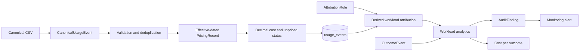

# StackAudit V0 — Architecture and Data Model

StackAudit V0 is a **single-user, local-first evidence ledger** for AI usage. It is designed to run on an operator's workstation or within an explicitly controlled private network boundary. It is **NOT** a production multi-tenant SaaS application.

Read [deployment guide](DEPLOYMENT.md), [self-hosting](SELF_HOSTING.md), [security policy](../SECURITY.md), and [database inventory](DATABASE.md) alongside this overview.

---

## 1. Architectural Principles and Trust Boundary

1. **Local-First Single Operator**: All computations, aggregations, and ingestion events are bound to one explicitly configured workspace (`STACKAUDIT_WORKSPACE_ORG_ID` or `STACKAUDIT_ORG_ID`).
2. **Explicit Workspace Resolution**: The server validates the organization exists and rejects any caller attempts to supply or switch organization contexts. It never selects an organization implicitly.
3. **Localhost Binding by Default**: Server scripts (`dev` and `start`) bind explicitly to `127.0.0.1`. Binding to wildcard `0.0.0.0` is blocked in local deployment mode.
4. **Service-Role Database Access & RLS Boundary**: The application server accesses PostgreSQL via the Supabase `service_role` key, which **bypasses Row-Level Security (RLS)**. RLS denies direct browser/anon/authenticated access to tables and RPCs, but within the Next.js backend, workspace isolation is enforced strictly by application code (`.eq('organization_id', orgId)`).

---

## 2. Main Data Path

The supported user-facing usage import is CSV. OpenAI and Anthropic adapter code is a library primitive: V0 has no direct background scraping or automated API key harvesting. Outcomes can be submitted with `POST /api/v1/outcomes`.

---

## 3. Canonical Records and Subsystems

### `CanonicalUsageEvent`
Application type in `core/types.ts`: stable event `id`; provider and model; event `timestamp`; `usage` (`inputTokens`, `outputTokens`, optional `cacheReadTokens`, `cacheCreationTokens`, `requestCount`); attribution hints (`apiKeyId`, optional tags); stable `providerReference`; `rawResponseHash`; optional capture time and unpriced flag.

The database stores normalized records in `usage_events`. Attribution is derived dynamically via the `v_attributed_usage_events` view by joining usage events to active attribution rules on `(organization_id, provider, match_type='api_key', match_value=api_key_id)`.

### `PricingRecord`
Contains provider, model, decimal-string rates for input, output, cache-read, and cache-creation tokens, effective-from and optional effective-until timestamps, source, and ID. Prices apply over `[effectiveFrom, effectiveUntil)`. The catalog expects exactly one matching record for the usage timestamp. Missing or incomplete rates mark usage as unpriced; overlapping records produce an ambiguous-price error.

Cost calculations use arbitrary-precision decimal arithmetic (`big.js`) across ordinary input, cache-read, cache-creation, and output components. Negative tokens or cached counts exceeding total input are rejected.

### `Workload` and `AttributionRule`
A workload represents a business workflow (e.g., "Customer Support Copilot", "Document Summarizer"). Attribution rules map provider API keys to workloads. A database uniqueness constraint enforces that `(organization_id, provider, match_type, match_value)` maps to at most one rule.

### `OutcomeEvent`
An outcome records an operator-reported business event: organization, workload reference, type, timestamp, positive count, optional JSON metadata, and an idempotency key. The API enforces that the referenced workload belongs to the operator's workspace.

### `AuditFinding`
Evidence-bearing results generated by heuristic audit rules comparing equal-length time windows:
- `USAGE_SPIKE`: Sudden volume surge.
- `COST_DRIFT`: Cost growth outpacing usage or outcomes.
- `TOKEN_EFFICIENCY`: Prompt token bloat or low cache hit rates.
- `MODEL_MIX`: Shift toward higher-cost models.

Findings are deduplicated and upserted by `(organization_id, workload_id, category, window_start, window_end)`.

### Monitoring and Alerts
Workload monitoring configurations evaluate active findings and manage alert lifecycles (`OPEN`, `ACKNOWLEDGED`, `RESOLVED`). Webhook channels deliver notifications with SSRF-safe DNS pinning and IPv4/IPv6 private address blocking.

---

## 4. Financial and Analytical Contracts

- **Total vs. Known Cost**: `knownCost` is the sum of priced usage. `totalCost` is strictly `null` if any event in the window is unpriced. Unpriced events are never treated as zero cost.
- **Cost Per Outcome (CPO)**: CPO is defined as total workload cost divided by outcome volume. It is valid only when:
  1. All usage in the window is priced (`isCostComplete = true`).
  2. Outcome count is positive (`> 0`).
  3. Exactly one outcome type exists in that workload and window.
  If multiple outcome types exist, CPO is withheld to prevent invalid cost attribution.

---

## 5. Unsupported Scenarios and Future Multi-Tenancy

StackAudit V0 must not be deployed as a public SaaS or shared multi-user application.

Before public multi-tenant deployment can be supported, StackAudit must implement:
- User identity, password hashing, and session management.
- Declarative PostgreSQL Row-Level Security policies enforced under user-authenticated roles.
- Multi-tenant organization membership and RBAC.
- Tenant-scoped authorization on all protected routes and actions.
- Cross-tenant isolation verification test suites.
- KMS-backed credential management and audit logging.
