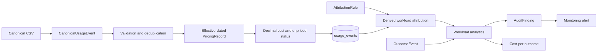

# StackAudit V0 architecture and data model

StackAudit V0 is a **single-user local preview**. It is a local ledger and analysis tool for one operator, not a production multi-tenant service. Read [self-hosting](SELF_HOSTING.md), [API reference](API_REFERENCE.md), and [database inventory](DATABASE.md) alongside this overview.

## Main data path

The supported user-facing usage import is CSV. OpenAI and Anthropic adapter code is a library primitive only: V0 has no provider credential connection, provider usage sync route, or scheduler for them. Outcomes can be submitted with `POST /api/v1/outcomes`.

## Canonical records

### `CanonicalUsageEvent`

Application type in `core/types.ts`: stable event `id`; provider and model; event `timestamp`; `usage` (`inputTokens`, `outputTokens`, optional `cacheReadTokens`, `cacheCreationTokens`, `requestCount`); attribution hints (`apiKeyId`, optional tags); stable `providerReference`; `rawResponseHash`; optional capture time and unpriced flag. The CSV adapter currently maps `api_key_id` and does not accept arbitrary tags or a caller-supplied event ID/hash.

The database stores the normalized values in `usage_events`. Attribution is not stored as a workload foreign key: the `v_attributed_usage_events` view joins an event to an attribution rule on organization, provider, `match_type='api_key'`, and `api_key_id=match_value`. A changed/deleted rule can therefore change historical workload attribution when queried later.

### `PricingRecord`

Contains provider, model, decimal-string rates for ordinary input/output and optional cache read/cache creation, effective-from and optional effective-until timestamps, source, and ID. Prices apply over `[effectiveFrom,effectiveUntil)`. The catalog expects exactly one matching provider/model record for the usage timestamp. Missing or incomplete rates produce an unpriced usage record; overlapping records produce an ambiguous-price error rather than a guess. The database has no exclusion constraint preventing overlapping effective periods.

Rates are per million tokens. `cacheReadTokens + cacheCreationTokens` are defined as subsets of total `inputTokens`; ordinary input is `input - cacheRead - cacheCreation`. Cost is computed with decimal arithmetic (`big.js`) as ordinary input, cache-read, cache-creation, and output components. Negative token/rate values or cached tokens greater than input are invalid. A required cache rate missing for a non-zero cache count makes the event unpriced.

### `Workload` and `AttributionRule`

A workload names an AI-backed business process. Rules map a provider plus a match type/value to one workload; the supported matching path is API key ID. A database uniqueness constraint makes one `(organization, provider, match type, match value)` map to at most one rule. The application does not validate provider or match type against an enum; only `api_key` is currently consumed by the attribution view.

### `OutcomeEvent`

An outcome records organization, optional workload reference, type, event timestamp, positive count, optional JSON metadata, and optional idempotency key. The API verifies that the workload belongs to the configured workspace and validates count/type/date/metadata size. The table does not enforce the cross-organization workload relationship or positive count.

An outcome count is an operator/application assertion; StackAudit does not verify that the business event really occurred. The schema has no event-level lifecycle, correction/reversal, reopened outcome, human-intervention, causal link to a specific AI request, or quality measurement. A submitter should correct upstream reporting and use new IDs/keys where appropriate; the current API has no outcome update/delete route.

### `AuditFinding`

An audit finding is an evidence-bearing result for a category and an effective time window. The registered audit rules currently evaluate `USAGE_SPIKE`, `COST_DRIFT`, `TOKEN_EFFICIENCY`, and `MODEL_MIX`. `RETRY_PATTERN` remains in the shared category type but has no registered rule. Severity/confidence levels are represented as text. `POST /api/v1/audits` compares a UTC-day-snapped current window with the immediately preceding window of equal length. It clamps the current end to UTC today and the earliest available sync watermark when one can be read. Findings are upserted by organization/workload/category/window so a repeat run refreshes evidence rather than duplicating that finding. Audits are heuristic explanations over imported records, not invoice reconciliation or proof of provider overbilling.

### Monitoring config, run, and alert

`monitoring_configs` stores an enabled flag, optional workload, evaluation-window settings, notification channels, and alert policy as JSON. Monitoring currently evaluates workload configs, not an organization-wide null-workload config. `monitoring_runs` records status, counts, and error text. An alert is deduplicated by a deterministic fingerprint containing organization, workload (or `global`), and category. It may be opened, acknowledged, resolved, reopened, or escalated as findings change. A monitoring run can automatically resolve alerts for evaluated categories that no longer fire.

Webhook dispatch code exists, but there is no public API/UI to configure monitoring configs or webhook channels. No claim of reliable background execution is made: the operator or external scheduler must call the monitoring endpoint. Its rate limiter is in-memory and suitable only for this single-process preview.

The forward migration `20261106000000_align_service_columns.sql` adds the alert retry/error bookkeeping columns and aligns the audit sync watermark column; see the [database inventory](DATABASE.md).

## Financial and analytical semantics

- Request count sums `request_count` (historical nulls use one).
- Tokens sum input plus output. Cache counts are not counted again because they are input subsets.
- `knownCost` is the priced subtotal. `totalCost` is `null` if any matching event is unpriced; a stored zero cost placeholder is never treated as confirmed cost.
- Attributed cost comes from current API-key rules. Unmatched events are reported separately as unattributed and are excluded from workload economics.
- Outcome count is the sum of event `count` within the same organization, workload, outcome type, and half-open window.
- CPO requires complete pricing, at least one outcome, and exactly one outcome type in the workload/window. It is full workload cost divided by the sole outcome count: an average ratio, not a causal allocation or per-request cost.
- USD is assumed by the current CPO response; there is no currency field on pricing rows or automatic FX handling.

See [ANALYTICS.md](../ANALYTICS.md) for the canonical metric contract and SQL reconciliation fixture.
