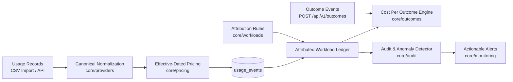

<div align="center">

# StackAudit

### Understand what your AI workloads actually cost.

[](LICENSE)
[](https://nextjs.org/)
[](https://supabase.com/)
[](https://www.typescriptlang.org/)
[](https://nodejs.org/)
[](#v0-preview-scope--trust-boundary)

<p align="center">
  <b>StackAudit</b> is an open-source AI Cost Intelligence platform that helps engineering teams track AI API usage, attribute spending to workloads, and understand the cost of producing meaningful outcomes.
</p>

[Quick Start](#quick-start-under-3-minutes) · [Documentation](docs/) · [How It Works](#how-it-works) · [Feature Matrix](#core-capabilities) · [Report a Bug](https://github.com/nitin-kumar-code/Ai-spend-audit/issues/new/choose) · [Contribute](CONTRIBUTING.md)

</div>

---

Instead of looking at AI spending as one large invoice at the end of the month, **StackAudit** helps you investigate:

* **Which workloads are consuming your AI budget?** Separate customer-facing copilot traffic from background batch jobs, evaluations, and internal tooling.
* **What does each workflow cost per outcome?** Calculate true unit economics, such as the exact AI cost to resolve a customer ticket, summarize a document, or onboard a user.
* **Where is usage increasing unexpectedly?** Spot consumption surges and token anomalies before they compound on your provider bills.
* **Which costs are unattributed or insufficiently priced?** Identify orphaned API keys and verify that token rates accurately capture prompt caching savings.
* **Where should engineering teams investigate optimization opportunities?** Pinpoint workloads experiencing model drift, excessive prompt token bloat, or low cache hit rates.

**Built for AI-native startups, developers, and engineering teams.**

---

## The 30-Second Briefing

| Question | Answer |
| :--- | :--- |
| **What is StackAudit?** | An open-source, local-first cost intelligence platform and analytics dashboard for AI engineering workloads. |
| **What problem does it solve?** | AI provider invoices are black boxes: they aggregate total token spend across thousands of requests with zero visibility into which feature or business workflow incurred the cost. StackAudit attributes token spend to specific engineering workloads and correlates costs with actual business outcomes. |
| **Who should use it?** | AI engineers, tech leads, engineering managers, and founders deploying OpenAI and Anthropic models who need visibility into their unit economics. |
| **How does it work?** | You import usage records via CSV or REST API. StackAudit normalizes usage across providers, applies versioned reference pricing with arbitrary decimal precision (`big.js`), maps usage to workloads via attribution rules, and calculates Cost Per Outcome (CPO). |
| **How can I install it?** | Run 4 commands with Docker and Node.js (`npm ci`, `npx supabase start`, `npm run setup`, `npm run dev`) to have a complete dashboard running locally in under 3 minutes. |
| **How can I contribute?** | Fork the repo, review our [Contributing Guide](CONTRIBUTING.md), pick up an issue, or add reference pricing fixtures for new models. |

---

## Product Preview

```text
┌────────────────────────────────────────────────────────────────────────────────────────┐
│  STACKAUDIT  │  Dashboard  ·  Usage  ·  Workloads  ·  Outcomes  ·  Audits  ·  Alerts   │
├────────────────────────────────────────────────────────────────────────────────────────┤
│                                                                                        │
│   TOTAL SPEND (30D)       TOTAL TOKENS            ACTIVE WORKLOADS      OPEN ALERTS    │
│   $1,482.35               412.8M                  6 Active              2 Requiring    │
│   ▲ +14.2% vs prev        (48.2% Cached)          100% Attributed       Attention      │
│                                                                                        │
├────────────────────────────────────────────────────────────────────────────────────────┤
│  DAILY SPEND TREND                                 WORKLOAD ATTRIBUTION                │
│  $ │              ╭───╮                            ┌────────────────────────────────┐  │
│    │        ╭─────╯   ╰───╮                        │ ■ Support Copilot      42.5%   │  │
│    │  ╭─────╯             ╰──────                  │ ■ Document Extraction  31.2%   │  │
│    │──╯                                            │ ■ Code Review Agent    18.1%   │  │
│    └─────────────────────────────                  │ ■ Other Workloads       8.2%   │  │
│                                                    └────────────────────────────────┘  │
├────────────────────────────────────────────────────────────────────────────────────────┤
│  UNIT ECONOMICS (COST PER OUTCOME)                                                     │
│  Workload               Outcome Metric            Volume        Cost / Outcome         │
│  Support Copilot        Resolved Tickets          8,420         $0.075 / ticket        │
│  Doc Extraction         Processed Invoices        14,100        $0.033 / document      │
│  Code Review Agent      Reviewed PRs              1,240         $0.216 / review        │
└────────────────────────────────────────────────────────────────────────────────────────┘
```

---

## How It Works



1. **Ingest & Normalize**: Provider records are normalized into canonical events capturing standard input/output tokens and prompt caching tokens (read & creation).
2. **Precision Pricing**: Effective-dated rate cards calculate exact monetary costs with `big.js` decimal arithmetic, preventing sub-cent floating-point rounding errors.
3. **Dynamic Attribution**: API key rules map usage events to business workloads without altering raw historical usage records.
4. **Outcome Correlation**: Workload expenditures are correlated against business events to calculate clean unit economics (Cost Per Outcome).
5. **Heuristic Audits**: Rule engines detect anomalies like unexpected token spikes, cost drift, prompt bloat, and model tier mix changes.

---

## Core Capabilities

- :white_check_mark: **Multi-Model Reference Pricing**: Pre-configured pricing catalog for OpenAI and Anthropic models with effective dating support.
- :white_check_mark: **Prompt Caching Economics**: Accurately accounts for cached input reads vs. cache creation writes to reflect true vendor invoices.
- :white_check_mark: **Arbitrary-Precision Financial Math**: Engineered with `big.js` to ensure financial figures are exact down to fractional cents.
- :white_check_mark: **Workload Attribution**: Map provider API keys to specific business workflows, teams, or services.
- :white_check_mark: **Cost Per Outcome (CPO) Metrics**: Track unit costs like cost per customer resolution, cost per legal document parsed, or cost per user onboarding.
- :white_check_mark: **Evidence-Based Auditing**: Automated detection across 4 categories: `USAGE_SPIKE`, `COST_DRIFT`, `TOKEN_EFFICIENCY`, and `MODEL_MIX`.
- :white_check_mark: **Interactive Usage Explorer**: Filter usage by date ranges, providers, models, and workloads with server-side pagination.
- :white_check_mark: **Deterministic 90-Day Demo**: Includes a synthetic data generator creating a realistic 90-day operational history with one command.

---

## V0 Preview Scope & Trust Boundary

> [!IMPORTANT]
> **StackAudit V0 is a single-user, local-first evidence ledger.**
> It is designed to run exclusively on an operator's workstation (`127.0.0.1`) or within an explicitly controlled, isolated private network boundary.
> It is **NOT** a public multi-tenant SaaS application.
> 
> * **Localhost Binding**: Next.js binds strictly to `127.0.0.1:3000` by default. Wildcard host binding (`0.0.0.0`) is prohibited in local mode.
> * **Single Operator Workspace**: All operations are explicitly scoped to `STACKAUDIT_WORKSPACE_ORG_ID`. The application never selects an organization implicitly.
> * **No Multi-Tenancy**: The current release does not include multi-tenant user authentication, user sessions, or team RBAC. Service-role database access bypasses PostgreSQL RLS.
> * **Safe Ingestion**: Supported via offline canonical CSV upload in the UI and programmatic REST API. It does not require or store your OpenAI/Anthropic API keys.
> 
> See **[DEPLOYMENT.md](docs/DEPLOYMENT.md)** and **[SECURITY.md](SECURITY.md)** for exhaustive details on deployment boundaries, security guardrails, and future multi-tenancy requirements.

---

## Quick Start (Under 3 Minutes)

Follow this sequence to set up a clean, fully populated instance on your machine.

### Prerequisites

- **Node.js**: `>= 22.22.2` and **npm**
- **Docker**: Docker Desktop (or running Docker daemon)
- **Supabase CLI**: Included in dependencies; run via `npx supabase`

### 1. Clone and Install Dependencies

```bash
git clone https://github.com/nitin-kumar-code/Ai-spend-audit.git
cd Ai-spend-audit/stackaudit
npm ci
```

### 2. Start Local Database and Configure Environment

```bash
# Start local Supabase Postgres instance
npx supabase start

# Copy sample environment configuration
cp .env.example .env.local
```

Retrieve your local credentials by running `npx supabase status`. Update `.env.local` with your `service_role` key:

```ini
STACKAUDIT_DEPLOYMENT_MODE=local
STACKAUDIT_DATABASE_MODE=local
NEXT_PUBLIC_SUPABASE_URL=http://127.0.0.1:54321
SUPABASE_SERVICE_ROLE_KEY=<service_role_key_from_supabase_status>
STACKAUDIT_WORKSPACE_ORG_ID=8a775c7f-e31c-8f9b-9000-000000000001
```

### 3. Initialize Schema and Demo Dataset

```bash
# 1. Apply database migrations
npx supabase db reset

# 2. Load pricing fixtures and seed 90 days of demo data
npm run setup
```

### 4. Launch the Dashboard

```bash
npm run dev
```

Open **[http://localhost:3000](http://localhost:3000)** in your browser to explore your local StackAudit instance!

---

## Available Commands

All commands are executed from within the `stackaudit/` directory:

| Command | Description |
| :--- | :--- |
| `npm run dev` | Starts the Next.js development server at `http://127.0.0.1:3000` |
| `npm run start` | Starts the production Next.js server bound to `127.0.0.1:3000` |
| `npm run setup` | Complete setup: loads pricing fixtures and seeds the demo dataset |
| `npm run pricing:load` | Loads reference pricing fixtures (`fixtures/pricing/reference-pricing-v1.json`) |
| `npm run seed` | Seeds deterministic 90-day demo usage, workloads, outcomes, and alerts |
| `npm run typecheck` | Verifies TypeScript types across the entire project |
| `npm run lint` | Runs ESLint rules and code style checks |
| `npm test` | Runs the Vitest unit test suite |
| `npm run test:integration` | Runs Supabase database integration tests |
| `npm run build` | Builds the production Next.js application bundle |

---

## Documentation

Comprehensive documentation is available in the [`docs/`](docs/) directory:

- 📖 **[Deployment Guide](docs/DEPLOYMENT.md)**: Security boundaries, host binding, and private-network configuration.
- 📖 **[Installation Guide](docs/INSTALLATION.md)**: Exhaustive setup instructions, system prerequisites, and troubleshooting.
- ⚙️ **[Configuration Reference](docs/CONFIGURATION.md)**: Environment variables, seed customization, and database security modes.
- 🏗️ **[Architecture & Data Model](docs/ARCHITECTURE.md)**: Internal subsystems, canonical records, and financial calculation semantics.
- 🔌 **[REST API Reference](docs/API_REFERENCE.md)**: Detailed endpoints, request/response contracts, and query bounds.
- 🖥️ **[Self-Hosting Guide](docs/SELF_HOSTING.md)**: Operational guide for local self-hosting and deployment boundaries.
- 🗄️ **[Database & Migrations](docs/DATABASE.md)**: Schema inventory, Postgres RPC aggregation functions, and indexing strategy.

---

## Roadmap

- [ ] **Streaming Proxy & Client SDK**: Lightweight TypeScript and Python wrappers for real-time request tagging.
- [ ] **Automated Provider Sync**: Secure scheduled imports from OpenAI and Anthropic usage reporting APIs.
- [ ] **Alert Webhooks**: Native notification integrations for Slack, Discord, and PagerDuty.
- [ ] **Multi-User Authentication**: Team accounts, organization switching, and role-based access control (RBAC).
- [ ] **Model Benchmark Overlays**: Contextualizing workload costs against quality/speed benchmark indexes.

---

## Contributing

We welcome contributions from the community! Whether you are reporting a bug, proposing new unit metrics, or adding pricing models, please check out our:

- 🤝 **[Contributing Guidelines](CONTRIBUTING.md)**
- 📜 **[Code of Conduct](CODE_OF_CONDUCT.md)**
- 🔒 **[Security Policy](SECURITY.md)**

---

## License

StackAudit is open-source software licensed under the **[Apache License, Version 2.0](LICENSE)**.
